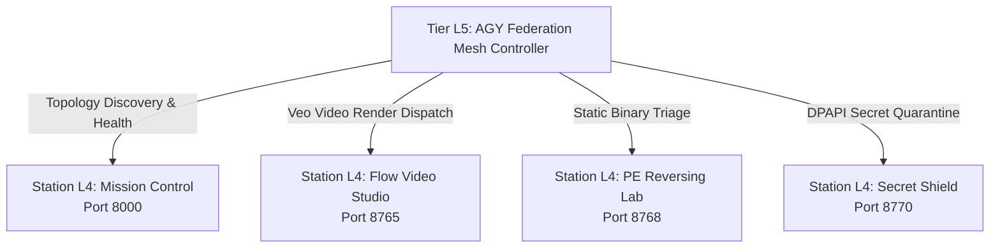

# AGY Federation Mesh

[](LICENSE)
[](pyproject.toml)
[](#architecture)

Tier L5 Federated Cross-Station Swarm Orchestrator and Distributed Directed Acyclic Graph (DAG) Execution Mesh.

---

## Architecture Overview



1. **Station Catalog & Mesh Topology**: Discovers and tracks active Tier L4 stations, validating endpoints, capabilities, and computing a deterministic 64-character SHA-256 mesh topology digest.
2. **DAG Execution Engine**: Validates task dependencies, resolves topological execution sequences, and rejects cyclic dependencies.
3. **Federated Orchestrator**: Executes multi-station workflows with circuit breaker protection, halting execution on station failures and recording W3C PROV-DM provenance logs.
4. **Command Matrix Cockpit**: Dark-mode web interface and REST API for real-time monitoring and pipeline triggering.

---

## Quickstart

```bash
# Query active mesh topology
python -m agy_federation_mesh.cli topology --json

# Run composite cross-station pipeline
python -m agy_federation_mesh.cli run --workflow security_reversing_audit --json

# Launch Command Matrix Web Cockpit
uvicorn agy_federation_mesh.l4_app:app --port 8780 --reload
```

---

## Verification

```bash
pytest tests/test_federation_mesh.py -v
```

---

## License

MIT (c) 2026 Obscured-grey.
